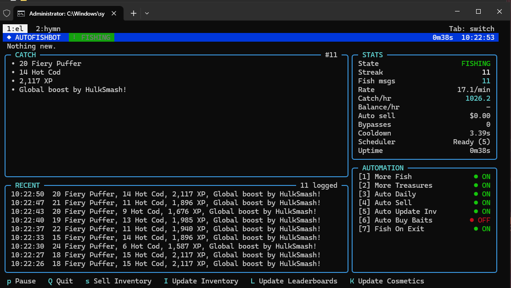

# AFB — Autofishbot
Auto fishing bot made in Python 3 for [Virtual Fisher](https://virtualfisher.com/) Discord bot.

Fork of [thejoabo/autofishbot](https://github.com/thejoabo/autofishbot) (upstream is archived) — actively maintained here, heavily refactored, with **multi-account support**.

## Screenshot



## Features
- Auto Fish
- Menu (TUI) — normal and compact mode
- Captcha solving via OCR.SPACE API (see [Captcha Information](#captcha-information))
- Full-featured: auto boosts, auto daily, auto sell, auto buy baits, auto update inventory
- Interactions (buttons and slash commands)
- **Multi-account**: run several accounts in one process, one terminal (see [Multi-account](#multi-account))
- Runtime automation toggles (keys `1`–`7`), persistable with `W`
- Session statistics (catches/hour, balance/hour, auto-sell totals)
- External notifications via Discord webhook or Telegram
- Proxy support (HTTPS), gateway auto-reconnect with backoff

## Requirements
- Python [3.10.6](https://www.python.org/downloads/release/python-3106/) or [later versions](https://www.python.org/downloads/)
- [Git](https://git-scm.com/downloads) (optional)
- On Windows, the TUI needs `windows-curses`: `pip install windows-curses`

## Installation
(**With** Git)
```bash
git clone https://github.com/hymndavinci/autofishbot.git
cd autofishbot
python -m pip install -r requirements.txt
```
(**Without** Git)
- Download the repository [here](https://github.com/hymndavinci/autofishbot/archive/refs/heads/main.zip)
- Extract the zip file, open a terminal in the folder, and run:
```bash
python -m pip install -r requirements.txt
```

## Usage
### Single account
Using the terminal, **in the repository folder**, type:
```bash
python autofishbot.py
```
- `python autofishbot.py <config_name>` — run the bot with a specific config file.
- `python autofishbot.py --create` — create a new config file.
- On first start, the bot will ask you to create a config file (stored in the `configs/` folder). Fill it in, then run the command again. With several config files, you will be prompted to choose one (by number or name).

### Multi-account
```bash
python multi.py                            # every *.config inside ./configs
python multi.py akun1.config akun2.config  # only the given files
```
One process, one terminal: every account keeps its own config, gateway connection, scheduler, dispatcher and menu, shown as tabs in a single curses screen.
- `Tab` / `Shift+Tab` — switch between accounts (all other keybinds apply to the account being shown)
- `Q` — quit all accounts
- Tab flags show each account's state: `DEAD`, `CAPTCHA`, `PAUSED`
- Accounts connect one after another (2–4 s stagger); configs sharing the same token are skipped
- If one account's worker thread dies, the others keep running

## Configuration
You can customize the options listed below in the config file — copy [assets/template.config](assets/template.config) into `configs/` and fill it in, or run `python autofishbot.py --create`:

```conf
[SYSTEM]
USER_TOKEN = YOUR TOKEN
USER_COOLDOWN = 3.5
CHANNEL_ID = YOUR CHANNEL ID
GUILD_ID = YOUR GUILD ID
DEBUG = FALSE

[CAPTCHA]
OCR_API_KEY = YOUR API KEY

[NETWORK]
USER_AGENT =
PROXY_IP =
PROXY_PORT =
PROXY_AUTH_USER =
PROXY_AUTH_PASSWORD =

[AUTOMATION]
BOOSTS_LENGTH = 5
MORE_FISH = FALSE
MORE_TREASURES = FALSE
FISH_ON_EXIT = FALSE
AUTO_DAILY = FALSE
AUTO_BUY_BAITS = FALSE
AUTO_SELL = FALSE
AUTO_UPDATE_INVENTORY = FALSE

[MENU]
COMPACT_MODE = FALSE
REFRESH_RATE = 0.3

[COSMETIC]
PET =
BAIT =
BIOME =

[NOTIFICATIONS]
DISCORD_WEBHOOK_URL =
TELEGRAM_BOT_TOKEN =
TELEGRAM_CHAT_ID =
```

> **Never commit or share your config files.** They live in `configs/`, are gitignored, and contain your Discord user token. Detailed information [here](assets/faq.md).

### Runtime toggles
While the bot runs, keys `1`–`7` toggle the seven automation options (more fish, more treasures, fish on exit, auto daily, auto buy baits, auto sell, auto update inventory). Press `W` to save the current toggle states to the active config file.

### Session statistics
The statistics panel reports catches per hour, estimated balance change per hour (from profile snapshots), and the amount attributed to confirmed/estimated automatic sales. Balance and sale totals are session-only.

### External notifications
Optional, in the `[NOTIFICATIONS]` section of the config:
- `DISCORD_WEBHOOK_URL`: Discord Incoming Webhook URL.
- `TELEGRAM_BOT_TOKEN` and `TELEGRAM_CHAT_ID`: Telegram Bot API destination.

Leave the values blank to disable external notifications.

## Captcha Information
All captchas are solved using the OCR.SPACE API for image to text recognition. The reason for choosing an online API was to avoid the annoyance of forcing users to install heavy image recognition modules (and saving the unnecessary effort of creating a specific image recognition model for this type of captcha). Among the API options, the most practical and accessible for the user is OCR.SPACE and, furthermore, it presented a reasonable consistency in correctly identifying the text in the image in the tests performed. **Therefore, to automatically solve the captchas, you will need an [API KEY](#how-do-i-get-my-free-key-)**.

The methodology is quite straight forward, when a new captcha is detected:

1. A request is sent asynchronously to the API for each available OCR engine
2. The answers are filtered to assert those with reasonable certainty
3. The filtered answers are tested

If all tests fail, a request to regenerate the captcha will be sent (up to 3 times). If the bot, ultimately, fails to solve all captchas, it will wait until you solve it manually.

Keep in mind that the captcha detection method is not flawless, unexpected events can cause some unusual behavior that could influence detection accuracy. Therefore, it should not be left alone without monitoring for longer periods of time.
### HOW DO I GET MY **FREE** KEY ?

All you need to do is use [any](https://temp-mail.io/en) email to get it here: https://ocr.space/ocrapi/freekey.

[Need more help ?](assets/faq.md#ocr_api_key)

## Reliability notes
- Purchase failures use a bounded exponential retry delay.
- Gateway reconnects use increasing delays and stop after 8 failed attempts; the terminal bell rings so you know manual intervention is needed.

## Changelog
Upstream history (up to experimental-2.0.0) lives in [assets/changelog.md](assets/changelog.md). A stable legacy build (1.2.1.1) can be found [here](assets/stable-legacy/stable-1.2.1.1.zip).

### This fork
- **Multi-account launcher** (`multi.py`): one process, tabbed curses UI, staggered connects, duplicate-token guard, per-account failure isolation
- **New modules**: `app/stats.py` (session statistics) and `app/notifications.py` (Discord webhook / Telegram)
- **Runtime toggles**: keys `1`–`7` plus `W` to persist automation state to the config (atomic save)
- **Reliability**: bounded exponential retry for purchases, gateway reconnect with backoff (8 attempts max)
- **Refactor**: `autofishbot.py`, `app/config.py`, `app/menu.py`, `app/scheduler.py` and `app/api_wrapper.py` reworked; config loading hardened (required-field validation, outdated-config detection)

## Contributing
- Pull requests are welcome. For major changes, open an issue first to discuss what you would like to change.
- If you notice any errors, bugs or strange behavior, **[please open an issue](https://github.com/hymndavinci/autofishbot/issues/new)** containing a screenshot or describing the problem.
- [**Suggestions**](https://github.com/hymndavinci/autofishbot/discussions/new) and [**Pull requests**](https://github.com/hymndavinci/autofishbot/pulls) are welcome.

## Credits
- Original project by [thejoabo](https://github.com/thejoabo) — this fork builds on his work.
